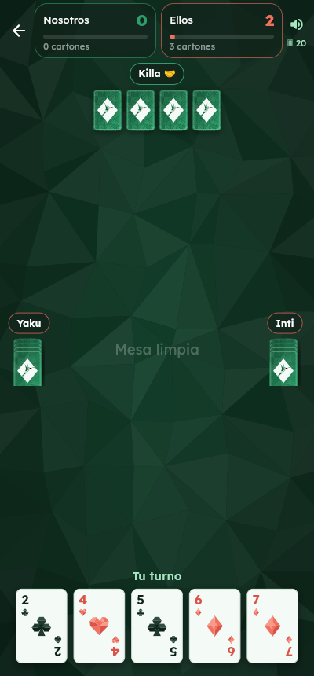
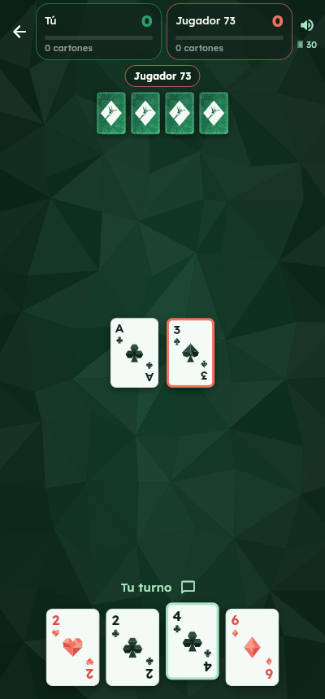

  

<h1 align="center">Quinde 40 🃏</h1>

<b>El cuarenta ecuatoriano</b>, para jugar en línea con tus amigos.

  <a href="https://quinde-40.web.app"><b>🌐 Jugar en el navegador</b></a> ·
  <a href="https://quinde-40.web.app/descargar"><b>📱 Descargar para Android</b></a>

## Capturas

| Inicio | Parejas contra bots | En línea |
|:---:|:---:|:---:|
|  |  |  |

## Qué trae

- **1 vs 1** y **2 vs 2 por parejas**.
- **Contra bots** sin internet, o **en línea** con salas de 4 letras.
- **Links de invitación**: compartes el link por WhatsApp y tu amigo entra directo a la sala.
- **Elige cómo llevar** cuando hay varias formas (carta igual o suma).
- **Chat con emojis**, aviso si alguien se desconecta y **volver a la sala** si se cierra la app.
- **Perfil con Google** (opcional), **ranking** de los mejores 20 y estadísticas.
- Cartas con identidad ecuatoriana: la **J es un quinde**, la **Q una flor andina** y la **K el volcán Imbabura**.

## Reglas

| | |
|---|---|
| **Baraja** | 40 cartas (A–7, J, Q, K). Se reparten 5 a cada uno. |
| **Llevar** | Con carta igual, o con A–7 dos cartas que sumen su valor. |
| **Escalera** | Después de llevar, te llevas las siguientes en orden (… 6, 7, J, Q, K). |
| **Caída** | +2 por llevarte la carta que el rival acaba de tirar. |
| **Limpia** | +2 por dejar la mesa vacía. |
| **Ronda** | +4 por recibir tres iguales (con cuatro iguales puedes ganar directo, se activa en Ajustes). |
| **Cartones** | Al acabar la baraja: 20 cartas = 6 puntos, +2 por cada par extra. |
| **38** | Con 38 puntos o más solo se gana con cartones. |
| **Meta** | Gana el primero en llegar a 40. |

## Instalar en Android

1. Descarga `quinde-40.apk` desde [la página de descarga](https://quinde-40.web.app/descargar) o desde [Releases](https://github.com/RiccijandroUpec/Quinde-40/releases/latest).
2. Ábrelo y, si Android lo pide, toca **Configuración** y activa **Permitir de esta fuente**.
3. Toca **Instalar**.

Requiere **Android 7.0** o superior. En iPhone se juega desde el navegador en https://quinde-40.web.app.

## Versiones

| Versión | Fecha | Novedades |
|---|---|---|
| [v1.0.0](https://github.com/RiccijandroUpec/Quinde-40/releases/tag/v1.0.0) | 27/10/2026 | Primera versión: 1 vs 1 y parejas, bots, en línea, chat, ranking y perfil con Google. |

---

Hecho en Ecuador 🇪🇨 con Flutter y Firebase

